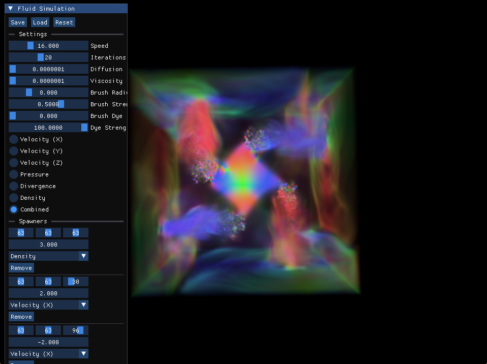
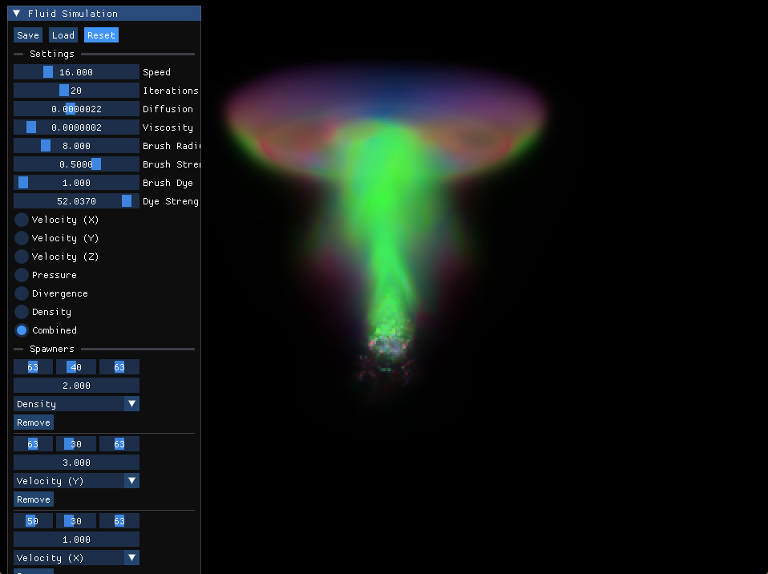
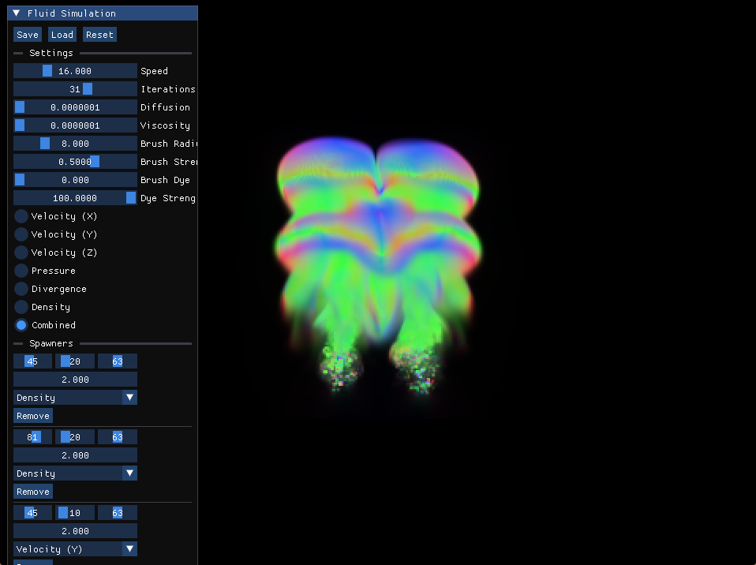
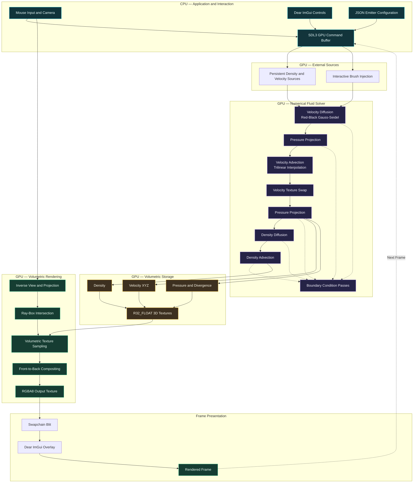

<div align="center">

  <h1>Fluid Simulation</h1>

  <p>
    <strong>Where mathematics flows into motion.</strong>
  </p>

  <p>
    An interactive, GPU-accelerated 3D fluid simulation exploring
    numerical methods, computational fluid dynamics, parallel computing,
    and volumetric rendering through C++ and compute shaders.
  </p>

  [](https://isocpp.org/)
  [](https://www.libsdl.org/)
  [](#gpu-computing)
  [](https://cmake.org/)
  [](./LICENSE.txt)

  <p>
    <a href="#overview">Overview</a> ·
    <a href="#fluid-dynamics">Fluid Dynamics</a> ·
    <a href="#simulation-pipeline">Pipeline</a> ·
    <a href="#gpu-computing">GPU Computing</a> ·
    <a href="#gallery">Gallery</a> ·
    <a href="#getting-started">Getting Started</a>
  </p>

</div>

<p align="center">
  <sub>
    Real-time volumetric fluid simulation driven by GPU compute pipelines.
    <br />
    Numerical methods · Parallel computing · Computational physics
  </sub>
</p>

## Overview

Fluid Simulation is a computational graphics project exploring the
behavior of three-dimensional fluid fields through numerical simulation
and GPU-accelerated visualization.

The simulation represents fluid motion within a volumetric grid,
where velocity, density, pressure, and divergence evolve according
to a sequence of numerical operations.

Unlike CPU-oriented implementations, the computational workload
is organized into dedicated GPU compute pipelines, allowing spatial
operations to be evaluated across large numbers of cells in parallel.

The resulting fluid fields are rendered using volumetric ray marching,
transforming numerical simulation data into an interactive
three-dimensional visual experience.

The project brings together several areas of computer science
and applied mathematics:

- Computational fluid dynamics.
- Numerical approximation and iterative solvers.
- Parallel algorithms and GPU computing.
- Three-dimensional spatial representation.
- Volumetric rendering and computer graphics.
- Interactive scientific visualization.

## Features

| Feature | Description |
| :--- | :--- |
| **3D Fluid Simulation** | Grid-based simulation of velocity and density fields. |
| **GPU Compute Pipeline** | Parallel numerical operations using the SDL3 GPU API. |
| **Volumetric Grid** | A 128 × 128 × 128 simulation domain. |
| **Velocity Diffusion** | Iterative approximation of viscous fluid behavior. |
| **Pressure Projection** | Correction of velocity fields toward incompressible flow. |
| **Semi-Lagrangian Advection** | Transport of velocity and density through the fluid domain. |
| **Red-Black Gauss-Seidel** | Parallel iterative relaxation for diffusion and pressure. |
| **Boundary Conditions** | Dedicated compute passes for simulation domain boundaries. |
| **Volumetric Ray Marching** | Three-dimensional rendering of simulated fluid fields. |
| **Interactive Fluid Brush** | Inject velocity and density directly into the simulation. |
| **Configurable Emitters** | Persistent sources of density and directional velocity. |
| **Field Visualization** | Inspect individual physical quantities or their combined representation. |
| **Scenario Persistence** | Save and load emitter configurations using JSON. |
| **Interactive Parameters** | Modify simulation and rendering settings through Dear ImGui. |

## Gallery

<div align="center">

  

  <sub>
    <strong>Multi-Source Fluid Interaction</strong> —
    combined volumetric visualization of interacting fluid fields.
  </sub>

</div>

<br />

<table>
  <tr>
    <td align="center" width="50%">
      
      <br />
      <sub><strong>Fluid Plume</strong></sub>
    </td>
    <td align="center" width="50%">
      
      <br />
      <sub><strong>Interacting Fluid Structures</strong></sub>
    </td>
  </tr>
</table>

## Fluid Dynamics

The simulation follows a grid-based numerical approach inspired
by the Stable Fluids family of methods.

Its mathematical foundation is related to the incompressible
Navier–Stokes equations, which describe the evolution of a
fluid velocity field.

### Mathematical foundation

The velocity equation can be expressed as:

$$
\frac{\partial \mathbf{u}}{\partial t}
+
(\mathbf{u}\cdot\nabla)\mathbf{u}
=
-\frac{1}{\rho}\nabla p
+
\nu\nabla^2\mathbf{u}
+
\mathbf{f}
$$

Subject to the incompressibility condition:

$$
\nabla\cdot\mathbf{u}=0
$$

Where:

| Symbol | Description |
| :---: | :--- |
| $\mathbf{u}$ | Fluid velocity field. |
| $p$ | Pressure field. |
| $\rho$ | Physical fluid density. |
| $\nu$ | Kinematic viscosity. |
| $\mathbf{f}$ | External forces. |
| $\nabla$ | Spatial differential operator. |

A transported scalar field, such as visual dye concentration,
can be described by an advection-diffusion equation:

$$
\frac{\partial d}{\partial t}
+
\mathbf{u}\cdot\nabla d
=
\kappa\nabla^2d+s
$$

Here, $d$ represents dye concentration, $\kappa$ represents
its diffusion coefficient, and $s$ represents external sources.

The simulation's density texture represents this transported
visual scalar rather than variable physical fluid density.

These equations describe the continuous mathematical model.
The application approximates their behavior using discrete
numerical operations on a finite three-dimensional grid.

### Spatial discretization

The fluid domain is represented by a regular volumetric grid.

| Property | Configuration |
| :--- | :--- |
| Spatial dimensions | 3 |
| Grid resolution | 128 × 128 × 128 |
| Allocated cells | 2,097,152 |
| Interior cells | 126 × 126 × 126 |
| Field precision | 32-bit floating point |
| Spatial representation | 3D GPU textures |
| Neighborhood | Six orthogonal neighbors |
| Solver iterations | Configurable from 1 to 50 |
| Default iterations | 7 |

Each grid cell stores numerical quantities associated with
the current fluid state.

### Simulation fields

| Field | Responsibility |
| :--- | :--- |
| Velocity X | Horizontal velocity component. |
| Velocity Y | Vertical velocity component. |
| Velocity Z | Depth-axis velocity component. |
| Pressure | Scalar field used during velocity projection. |
| Divergence | Local measure of velocity-field expansion or compression. |
| Density | Transported scalar used for volumetric visualization. |

Together, the three velocity components form a vector field:

$$
\mathbf{u}(x,y,z)
=
\begin{bmatrix}
u_x(x,y,z)\\
u_y(x,y,z)\\
u_z(x,y,z)
\end{bmatrix}
$$

## Numerical Methods

The fluid solver decomposes each simulation step into
several numerical operations with distinct responsibilities.

### Diffusion

Diffusion approximates the spreading of scalar quantities
and the smoothing of velocity variations throughout
the simulation domain.

The underlying diffusion equation is:

$$
\frac{\partial q}{\partial t}
=
\kappa\nabla^2q
$$

The implementation uses iterative relaxation over a
six-neighbor spatial stencil.

For an interior grid cell, the linear update takes
the following general form:

$$
q_i^{new}
=
\frac{
q_i^{source}
+
a\displaystyle\sum_{j\in\mathcal{N}(i)}q_j
}{
1+6a
}
$$

Where $\mathcal{N}(i)$ represents the six orthogonal
neighbors of the current cell.

Velocity diffusion is controlled by viscosity, while
density diffusion uses its own configurable coefficient.

### Semi-Lagrangian advection

Advection transports quantities through the velocity field.

Instead of moving each grid cell forward, the semi-Lagrangian
method traces backward from a destination position to estimate
where its contents originated.

Conceptually:

$$
\mathbf{x}_{previous}
=
\mathbf{x}
-
\Delta t\,\mathbf{u}(\mathbf{x})
$$

The transported quantity is then sampled at that position:

$$
q^{new}(\mathbf{x})
=
q^{old}(\mathbf{x}_{previous})
$$

Because the reconstructed position generally lies between
discrete grid cells, the implementation uses trilinear
interpolation across eight neighboring samples.

This approach is applied to both velocity and dye density.

### Pressure projection

Pressure projection reduces the divergence of the velocity
field to approximate incompressible fluid motion.

The operation consists of three principal stages:

1. Compute the divergence of the intermediate velocity field.
2. Iteratively approximate the pressure field.
3. Subtract the pressure gradient from the velocity field.

In conceptual form:

$$
\nabla^2p=\nabla\cdot\mathbf{u}^{*}
$$

$$
\mathbf{u}^{new}
=
\mathbf{u}^{*}-\nabla p
$$

The equations use normalized notation for the projection step.

The resulting velocity field approaches the
divergence-free condition, subject to discretization
and solver convergence.

### Red-Black Gauss-Seidel

The diffusion and pressure solvers use a two-phase
relaxation strategy based on spatial parity.

Grid cells are assigned to one of two groups:

$$
c(x,y,z)=(x+y+z)\bmod 2
$$

Cells belonging to the same parity group can be updated
in parallel because their orthogonal neighbors belong
to the opposite group.

```text
        Phase 0                  Phase 1

      R B R B R                B R B R B
      B R B R B                R B R B R
      R B R B R                B R B R B
      B R B R B                R B R B R

      Red cells                Black cells
       updated                   updated
```

This illustration shows a two-dimensional slice of the
three-dimensional parity arrangement.

Each iteration executes both phases, followed by
the corresponding boundary updates.

This organization adapts an iterative numerical method
to GPU parallel execution.

## Simulation Pipeline

The simulation separates CPU-side orchestration from
GPU-side numerical computation and volumetric rendering.

The following diagram represents the actual ordering
of the principal simulation operations and their
relationship with the rendering pipeline.



The numerical solver runs at a configured update interval,
while volumetric rendering is performed during the
application's frame-update cycle.

Boundary conditions are applied throughout the numerical
process rather than exclusively at the end of the simulation.

## GPU Computing

The computational implementation is built around the
SDL3 GPU API and dedicated HLSL compute shaders.

Instead of evaluating every spatial cell sequentially
on the CPU, the application dispatches groups of GPU
threads over the simulation domain.

### Compute configuration

| Property | Configuration |
| :--- | :--- |
| Compute pipelines | 15 |
| Volumetric workgroup | 8 × 8 × 8 |
| Threads per volumetric workgroup | 512 |
| Rendering workgroup | 8 × 8 × 1 |
| Field texture format | `R32_FLOAT` |
| Output texture format | `RGBA8` |
| Shader language | HLSL |
| Packaged shader formats | SPIR-V and MSL |

Workgroup dimensions vary between numerical,
boundary-processing, and rendering operations.

### Compute shader organization

| Shader | Responsibility |
| :--- | :--- |
| `add1.comp` | Inject a scalar value into a selected field. |
| `clear.comp` | Initialize or reset volumetric textures. |
| `diffuse.comp` | Iterative diffusion of velocity or density. |
| `advect1.comp` | Transport individual velocity components. |
| `advect2.comp` | Transport the density field. |
| `project1.comp` | Calculate divergence and initialize pressure. |
| `project2.comp` | Iteratively solve the pressure field. |
| `project3.comp` | Apply pressure-gradient correction to velocity. |
| `bnd1.comp` – `bnd5.comp` | Process simulation boundary conditions. |
| `brush.comp` | Inject localized density and directional velocity. |
| `raymarch.comp` | Generate the volumetric visualization. |

Shared mathematical operations are implemented in
[`shader.hlsl`](./shaders/shader.hlsl).

The CPU coordinates pipeline selection, resource bindings,
uniform parameters, command submission, and texture management.

### GPU texture management

Each simulation field is represented by a pair of
three-dimensional floating-point textures.

The `ReadWriteTexture` abstraction manages read and write
resources, allowing operations that require separate input
and output fields to use a ping-pong strategy.

```text
      Read Texture                 Write Texture
    ┌──────────────┐              ┌──────────────┐
    │ Current Field│ ── Compute ─▶│ Updated Field│
    └──────────────┘              └──────────────┘
            ▲                             │
            └────────── Swap ─────────────┘
```

Other operations, including the two-phase relaxation
solver, update the appropriate GPU storage texture in place.

### Memory representation

The nominal size of a single floating-point field is:

$$
128^3\times4=8,388,608\text{ bytes}
$$

| GPU Resource | Nominal Payload |
| :--- | ---: |
| Single volumetric texture | 8 MiB |
| Double-buffered field | 16 MiB |
| Six double-buffered fields | 96 MiB |
| Scratch texture | 8 MiB |
| Core volumetric storage | 104 MiB |

These figures describe raw texture payload sizes.

Actual GPU memory consumption also includes output textures,
driver allocations, resource alignment, graphics pipelines,
and interface rendering resources.

## Volumetric Rendering

The visualization layer uses compute-based ray marching
to render three-dimensional fluid fields into a
two-dimensional output texture.

For each output pixel, a viewing ray is constructed
using the inverse camera view and projection matrices.

The ray is represented as:

$$
\mathbf{r}(t)=\mathbf{o}+t\mathbf{d}
$$

Where:

- $\mathbf{o}$ is the camera position.
- $\mathbf{d}$ is the normalized ray direction.
- $t$ is the distance along the ray.

The renderer calculates the intersection between this
ray and the simulation domain, then samples the
volumetric textures along the intersecting segment.

### Opacity accumulation

Sample opacity is calculated using an exponential
attenuation model:

$$
\alpha=1-e^{-\sigma\Delta s}
$$

Where $\sigma$ represents the sampled field intensity
scaled by the rendering parameters and $\Delta s$
represents the ray-marching step size.

Samples are accumulated using front-to-back compositing:

$$
C_{new}=C_{old}+(1-A_{old})\alpha c
$$

$$
A_{new}=A_{old}+(1-A_{old})\alpha
$$

The implementation also supports early termination when
the accumulated opacity approaches its configured threshold.

### Rendering configuration

| Property | Configuration |
| :--- | :--- |
| Rendering technique | Volumetric ray marching |
| Intersection geometry | Axis-aligned simulation volume |
| Nominal step size | 1 grid-coordinate unit |
| Maximum ray steps | 512 |
| Early termination threshold | 0.99 opacity |
| Sampling | Volumetric texture sampling |
| Compositing | Front-to-back alpha accumulation |

### Visualization modes

The interface provides seven field visualization modes.

| Mode | Visualization |
| :--- | :--- |
| Velocity X | Magnitude of the X-axis velocity component. |
| Velocity Y | Magnitude of the Y-axis velocity component. |
| Velocity Z | Magnitude of the Z-axis velocity component. |
| Pressure | Magnitude of the computed pressure field. |
| Divergence | Magnitude of local velocity-field divergence. |
| Density | Distribution of transported dye. |
| Combined | Density and velocity-based volumetric coloring. |

The combined mode derives color from the relative
magnitudes of the velocity components and opacity
from density and velocity magnitude.

## Interactive Simulation

The application exposes numerical and graphical parameters
through a Dear ImGui control interface.

### Simulation parameters

| Parameter | Default | Description |
| :--- | ---: | :--- |
| Speed | 16.0 | Controls the numerical simulation time step. |
| Iterations | 7 | Iterative diffusion and pressure solver passes. |
| Diffusion | 0.0000512 | Scalar density diffusion coefficient. |
| Viscosity | 0.000004 | Velocity diffusion coefficient. |
| Brush Radius | 8.0 | Spatial extent of brush interaction. |
| Brush Strength | 0.5 | Strength of injected velocity. |
| Brush Dye | 1.0 | Density injected through the brush. |
| Dye Strength | 2.0 | Volumetric visualization intensity. |

### Fluid emitters

Persistent emitters, internally represented as spawners,
allow density or velocity to be introduced into the
simulation at configurable spatial coordinates.

Each emitter contains:

- A three-dimensional position.
- A target simulation field.
- A scalar injection value.

Multiple emitters can be combined to construct interacting
flows and different volumetric structures.

### Controls

| Input | Action |
| :--- | :--- |
| Left Mouse + Drag | Orbit the camera around the simulation volume. |
| Right Mouse + Drag | Inject velocity and dye using the fluid brush. |
| Mouse Wheel | Adjust camera distance. |
| `R` | Reset the simulation fields. |
| Save | Export the current emitter configuration. |
| Load | Import an emitter configuration from JSON. |
| Reset | Reinitialize the fluid fields. |
| Drag and Drop JSON | Load an emitter scenario. |

## Simulation Scenarios

The repository includes nine predefined configurations
inside the [`samples/`](./samples/) directory.

These files describe combinations of spatially positioned
density and velocity emitters.

```text
samples/
├── 1.json
├── 2.json
├── 3.json
├── 4.json
├── 5.json
├── 6.json
├── 7.json
├── 8.json
└── 9.json
```

Scenarios can be loaded through the application interface,
dragged into the simulation window, or provided as a
command-line argument.

From the repository root:

```bash
./build/bin/fluid_simulation samples/1.json
```

On Windows:

```powershell
.\build\bin\fluid_simulation.exe samples\1.json
```

JSON persistence stores emitter configurations rather
than complete volumetric snapshots of the fluid state.

## Technology Stack

<div align="center">

  

</div>

| Technology | Responsibility |
| :--- | :--- |
| **C++23** | Application architecture and GPU orchestration. |
| **SDL3 GPU API** | Compute pipelines, textures, command buffers, and frame presentation. |
| **HLSL** | Numerical solver and rendering compute shaders. |
| **SPIR-V** | Compiled shader representation for compatible GPU backends. |
| **Metal Shading Language** | Shader representation used by the Apple build configuration. |
| **GLM** | Vector mathematics, matrices, and camera transformations. |
| **Dear ImGui** | Interactive simulation configuration. |
| **nlohmann/json** | Serialization of emitter configurations. |
| **CMake** | Native build configuration and shader packaging. |
| **SDL_shadercross** | Optional shader compilation and cross-compilation. |

## Getting Started

### Requirements

- A C++23-compatible compiler and standard library.
- CMake 3.24 or later.
- Git with submodule support.
- A compatible GPU and graphics driver.
- Platform-specific SDL development dependencies.

The principal third-party libraries are included
through Git submodules or vendored source code.

### Clone the repository

```bash
git clone --recurse-submodules \
    https://github.com/4beru/fluid-simulation.git

cd fluid-simulation
```

If the repository has already been cloned:

```bash
git submodule update --init --recursive
```

### Linux

Configure a release build:

```bash
cmake -S . -B build \
    -DCMAKE_BUILD_TYPE=Release
```

Compile the application:

```bash
cmake --build build --parallel
```

Launch the simulation:

```bash
./build/bin/fluid_simulation
```

Linux may require additional system libraries for
building SDL and accessing the graphics environment.

See the repository's
[build workflow](./.github/workflows/build.yml)
for the configured CI dependencies.

### Windows

Using a compatible Visual Studio or CMake development
environment:

```powershell
cmake -S . -B build

cmake --build build --parallel --config Release

.\build\bin\fluid_simulation.exe
```

### Shader compilation

The repository includes pre-generated shader resources
inside `shaders/bin/`.

Consequently, an additional shader compiler is not
required for a standard build.

To regenerate shaders after modifying their source code,
install SDL_shadercross and ensure that the `shadercross`
executable is available in your system PATH.

Verify availability:

```bash
shadercross --help
```

Then configure and build the project normally:

```bash
cmake -S . -B build -DCMAKE_BUILD_TYPE=Release

cmake --build build --parallel
```

CMake automatically detects the shader compiler and
configures the corresponding compilation targets.

### Shader artifacts

| Extension | Purpose |
| :--- | :--- |
| `.comp` | HLSL compute shader source. |
| `.spv` | Compiled SPIR-V shader. |
| `.msl` | Metal Shading Language representation. |
| `.json` | Shader resource and workgroup metadata. |

Generated shader resources are copied into the
application's binary directory during the build.

> [!NOTE]
> The repository includes a CI configuration targeting Linux,
> Windows, and macOS. Successful execution on a particular
> system depends on compiler, driver, and GPU backend
> compatibility.

---

<div align="center">

  <h3>Order, emerging from chaos.</h3>

  <p>
    Part of <strong>Computational Simulation</strong> — a collection
    of projects exploring numerical methods, mathematical modeling,
    physical phenomena, and the computational representation
    of dynamic systems.
  </p>

  <p>
    <sub>Curated by Abel Ortega.</sub>
  </p>

  <a href="https://github.com/4beru">GitHub</a> ·
  <a href="https://www.aberu.site">Portfolio</a>

</div>
